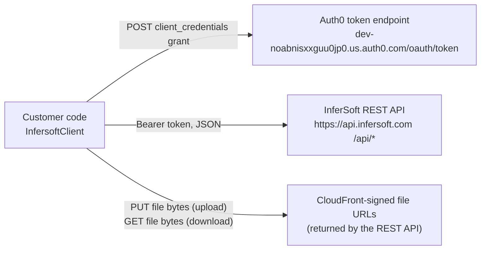
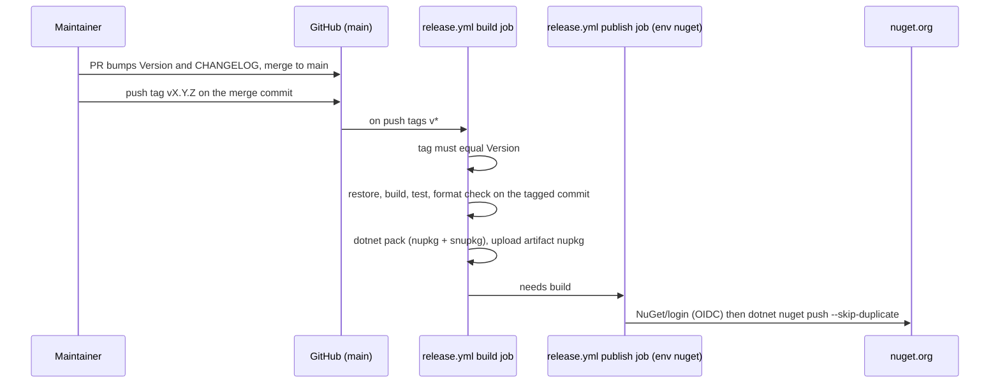

# Maintaining infer-dotnet

`infer-dotnet` is the .NET client for the InferSoft public REST API, published to NuGet as [`Infersoft`](https://www.nuget.org/packages/Infersoft). It is hand-written: there is no code generator, and every model, resource member and selector factory was written against the API's OpenAPI spec ([api.infersoft.com/openapi.yaml](https://api.infersoft.com/openapi.yaml)). The Python SDK, [infer-python](https://github.com/InferSoft-inc/infer-python), exposes the same surface, so an API change normally lands in both SDKs.

The customer-facing docs are [README.md](../README.md) (behavior and examples), [api.md](../api.md) (every public member and the REST calls it makes) and [CHANGELOG.md](../CHANGELOG.md). Keep all three accurate in the same PR as a code change. README.md is packed into the NuGet package (`PackageReadmeFile` in [`Infersoft.csproj`](../src/Infersoft/Infersoft.csproj)) and shown on nuget.org, which is why its links are absolute GitHub URLs.

## What the SDK talks to



| Dependency | How the SDK reaches it | Code |
|---|---|---|
| Auth0 token endpoint | `ClientCredentialsHandler` (a `DelegatingHandler` on the API `HttpClient`) fetches a client-credentials token, caches it until 60 s before expiry, refreshes single-flight and retries once with a fresh token on a 401. Token requests have their own 30 s timeout. | [`Internal/ClientCredentialsHandler.cs`](../src/Infersoft/Internal/ClientCredentialsHandler.cs) |
| REST API | The API `HttpClient` (`BaseAddress` = base URL, `User-Agent: infersoft-dotnet/<version>`), driven by `RequestPipeline` for timeouts, retries and error mapping. | [`InfersoftClient.cs`](../src/Infersoft/InfersoftClient.cs), [`Internal/RequestPipeline.cs`](../src/Infersoft/Internal/RequestPipeline.cs) |
| CloudFront-signed file URLs | A second `HttpClient` without the auth handler (a bearer token would break the signature), using `UploadTimeout` and `UploadMaxRetries`. | [`Internal/RequestPipeline.cs`](../src/Infersoft/Internal/RequestPipeline.cs) (`PutPresigned*` / `GetPresigned*`) |

The defaults (`https://api.infersoft.com` for base URL and audience, the `dev-noabnisxxguu0jp0` Auth0 tenant for the token URL) are the production values. The API accepts only tokens whose audience is its own base URL, so `BaseUrl`, `TokenUrl` and `Audience` are overridden together (`InfersoftClientOptions` or the `INFERSOFT_BASE_URL`, `INFERSOFT_TOKEN_URL` and `INFERSOFT_AUDIENCE` environment variables), with credentials issued for that environment.

The interactive API docs are at [api.infersoft.com/documentation](https://api.infersoft.com/documentation/) and the spec at [api.infersoft.com/openapi.yaml](https://api.infersoft.com/openapi.yaml).

## Local development

These are the commands CI runs (requires the .NET 10 SDK from `global.json`, plus the .NET 8 runtime to run the tests):

```bash
dotnet restore
dotnet build --no-restore -c Release
dotnet test --no-build -c Release
dotnet format --verify-no-changes
```

Run one sample against a real account (names: `extract`, `search`, `bulk`, `download`, `concurrent`). The samples read credentials from `INFERSOFT_CLIENT_ID` and `INFERSOFT_CLIENT_SECRET`:

```bash
dotnet run --project examples/Infersoft.Examples -- extract
```

The samples have fixed inputs in [`Program.cs`](../examples/Infersoft.Examples/Program.cs); edit them for the account first. `extract` uploads `invoice-1.pdf` and `invoice-2.pdf` from the working directory and extracts prompts 101 and 102, `search` reads prompts 101 and 102 for folder 7, `bulk` uploads every `*.pdf` under `./pdfs` (subfolders included) into the project `Imports`, `download` writes every document of the organization into `./downloads`, and `concurrent` reads documents 1, 2 and 3. `extract` and `bulk` create documents, and `extract` runs a job that spends credits.

## CI

[`.github/workflows/ci.yml`](../.github/workflows/ci.yml) runs on every pull request and on pushes to `main`: restore, Release build of both target frameworks (warnings as errors, public-API analyzer), tests, and `dotnet format --verify-no-changes`. It needs no secrets. Actions are pinned to commit SHAs.

`main` is the default branch and the only release branch. [CODEOWNERS](../.github/CODEOWNERS) assigns every path to the `InferSoft-inc/infersoft-it` team.

## Releasing to NuGet

Versions follow Semantic Versioning. The version lives only in `<Version>` in [`Directory.Build.props`](../Directory.Build.props); it also becomes the `User-Agent` suffix (read from the assembly's informational version in [`Internal/SdkInfo.cs`](../src/Infersoft/Internal/SdkInfo.cs)).



1. In a PR to `main`, set `<Version>` in `Directory.Build.props` and move the `## [Unreleased]` notes in CHANGELOG.md under `## [X.Y.Z] - <date>`. Merge it.
2. Tag the merge commit by its SHA (a bare `git tag` would tag whatever is checked out locally) and push the tag:
   ```bash
   git fetch origin
   git tag vX.Y.Z <merge commit SHA>
   git push origin vX.Y.Z
   ```
3. [`.github/workflows/release.yml`](../.github/workflows/release.yml) builds and publishes:
   - **build & verify**: fails unless the tag without its `v` equals `<Version>`, reruns the CI gates with `ContinuousIntegrationBuild=true`, packs `src/Infersoft/Infersoft.csproj` (package plus `.snupkg` symbols, SourceLink embedded) and uploads it as the `nupkg` artifact.
   - **publish to NuGet**: runs in the GitHub environment `nuget`, which only accepts refs matching the tag pattern `v*`. It has `id-token: write`; `NuGet/login` exchanges the GitHub OpenID Connect (OIDC) token for a short-lived API key using the nuget.org account named by the `NUGET_USER` repository or organization variable (a variable, not a secret), and `dotnet nuget push --skip-duplicate` uploads to `https://api.nuget.org/v3/index.json`. There is no stored NuGet API key. The nuget.org trusted publishing policy must stay registered for this repo and `release.yml`.

A tag pushed on a commit whose `<Version>` does not match fails the version check and publishes nothing.

Published versions and their dates are on [nuget.org](https://www.nuget.org/packages/Infersoft) and in [CHANGELOG.md](../CHANGELOG.md).

## Code layout

| Path | What it holds |
|---|---|
| [`src/Infersoft/InfersoftClient.cs`](../src/Infersoft/InfersoftClient.cs) | Client construction, `INFERSOFT_*` fallbacks, `WithOptions`, disposal. |
| [`src/Infersoft/InfersoftClient.Extract.cs`](../src/Infersoft/InfersoftClient.Extract.cs) | The `Extract` / `ExtractAsync` pipeline. |
| [`src/Infersoft/InfersoftClientOptions.cs`](../src/Infersoft/InfersoftClientOptions.cs) | Public options and their defaults. |
| [`src/Infersoft/Resources/`](../src/Infersoft/Resources/) | `DocumentsResource` (uploads in `DocumentsResource.Uploads.cs`), `FoldersResource`, `ProjectsResource`, `PromptsResource`, `JobsResource`. Every member has a sync and an `…Async` form. |
| [`src/Infersoft/Models/`](../src/Infersoft/Models/) | Response models, all derived from `InfersoftModel`, whose `[JsonExtensionData] AdditionalData` keeps unknown server fields. Status and data-type enums are extensible (`ExtensibleEnumConverter`). Also the SDK's own result types (`UploadResult`, `FileOutcome`, `ExtractResult`), which are not server models. |
| [`src/Infersoft/Internal/Requests/`](../src/Infersoft/Internal/Requests/) | Request body types. JSON uses `JsonNamingPolicy.SnakeCaseLower` ([`Internal/InfersoftJson.cs`](../src/Infersoft/Internal/InfersoftJson.cs)). |
| [`src/Infersoft/Internal/RetryPolicy.cs`](../src/Infersoft/Internal/RetryPolicy.cs) | Retry statuses, backoff, `Retry-After` handling, request-in-progress 409 detection. |
| [`src/Infersoft/Internal/Polling.cs`](../src/Infersoft/Internal/Polling.cs) | Waiters and default budgets (30 minutes for jobs, 10 minutes for documents, 2 s interval). |
| [`src/Infersoft/Internal/ApiErrors.cs`](../src/Infersoft/Internal/ApiErrors.cs), [`Exceptions/`](../src/Infersoft/Exceptions/) | Status code to exception mapping and the exception types. |
| [`src/Infersoft/Selectors.cs`](../src/Infersoft/Selectors.cs) | `Selector` factories (one per selector type in the spec, plus `Raw`) and `Selectors.Build`. |
| [`src/Infersoft/PublicAPI.*.txt`](../src/Infersoft/PublicAPI.Unshipped.txt) | Public API baseline for `Microsoft.CodeAnalysis.PublicApiAnalyzers`. Every public member must be listed or the build fails (warnings are errors). Add new members to `PublicAPI.Unshipped.txt`. |
| [`tests/Infersoft.Tests/`](../tests/Infersoft.Tests/) | xUnit tests on `net8.0`. HTTP goes through a fake `HttpMessageHandler` passed as `Transport`, so no credentials or network are needed. |
| [`examples/Infersoft.Examples/`](../examples/Infersoft.Examples/) | Sample console app in the solution, so CI compiles it; running it needs real credentials. |

Shared build settings are in [`Directory.Build.props`](../Directory.Build.props): nullable enabled, `TreatWarningsAsErrors`, `EnforceCodeStyleInBuild`, `AnalysisMode=Recommended`, and the package `<Version>`. The library targets `net8.0` and `netstandard2.0`; the sync members use real synchronous `HttpClient.Send` under `NET8_0_OR_GREATER` and bridge over the async path on `netstandard2.0`. [`global.json`](../global.json) pins the SDK to `10.0.404` with `rollForward: latestPatch`; the SDK version is independent of the target frameworks.

## How the SDK maps to the REST API

The API records and replays responses per `Idempotency-Key` on its write routes (in the spec, the operations whose responses advertise `Idempotency-Replayed`) and ignores the header everywhere else: the read-style `POST` searches, `POST /api/folders/paths` and `DELETE`. The SDK follows the same split: it sends a key (auto-generated `Guid` "N" format, or the caller's `idempotencyKey`) only to the recorded routes, and passes `idempotent: true` for read-style `POST`s so they are retried without a key.

| Route | SDK members | SDK sends `Idempotency-Key` |
|---|---|---|
| `POST /api/uploads` | `Documents.Upload`, `UploadMany`, `UploadManyFromDirectory` (key `<base>-NNNN` per batch) | yes |
| `POST /api/documents/search` | `Documents.Search`, `Iterate`, `GetValues`, `WaitUntilReady`, `Jobs.Results` | no |
| `GET /api/documents/{id}` | `Documents.Get`, `Download` (name lookup) | no |
| `GET /api/documents/{id}/download` | `Documents.DownloadUrl`, `Download` | no |
| `DELETE /api/documents/{id}` | `Documents.Delete`, `Upload(onDuplicate: Block)` | no |
| `POST /api/documents/move-to-folder` | `Documents.MoveToFolder` | yes |
| `POST /api/documents/bulk_delete` | `Documents.BulkDelete` | yes |
| `POST /api/folders` | `Folders.Create` | yes |
| `GET /api/folders/{id}` | `Folders.Get` | no |
| `PATCH /api/folders/{id}` | `Folders.Rename` | yes |
| `POST /api/folders/search` | `Folders.Search`, `Iterate` | no |
| `POST /api/folders/move` | `Folders.Move` | yes |
| `POST /api/folders/paths` | `Folders.ResolvePaths`, `EnsurePath` | no |
| `POST /api/folders/bulk_delete` | `Folders.BulkDelete` | yes |
| `POST /api/projects` | `Projects.Create`, `GetOrCreate` | yes |
| `GET /api/projects/{id}` | `Projects.Get` | no |
| `POST /api/projects/search` | `Projects.Search`, `Iterate`, `GetOrCreate` | no |
| `POST /api/projects/assign-documents` | `Projects.AssignDocuments` | yes |
| `POST /api/prompts/search` | `Prompts.Search`, `Iterate` | no |
| `POST /api/jobs/credits/estimate` | `Jobs.Estimate`, `Run` | yes |
| `POST /api/jobs/credits/quote` | `Jobs.Quote` | no |
| `POST /api/jobs/start` | `Jobs.Start`, `Run` | yes |
| `GET /api/jobs/{id}` | `Jobs.Get`, `Wait`, `Run(wait: true)` | no |
| `POST /api/jobs/search` | `Jobs.Search`, `Iterate` | no |

Routes in the spec that the SDK deliberately does not wrap: `POST /api/documents/{id}/resplit` and `POST /api/documents/{id}/split` (marked deprecated and internal-only in the spec) and `POST /api/documents/extraction_results/search` (deprecated; extraction values come from `Documents.Search` with `prompts`).

### Server contracts copied by hand

These values live in the SDK and in the API. Change them together.

| SDK | REST API |
|---|---|
| `RetryPolicy.ProblemTypeRequestInProgress` | The problem `type` `https://api.infersoft.com/problems/request-in-progress` in the spec (the transient 409 the SDK retries, honoring `Retry-After`) |
| `DocumentsResource.MaxBatchFiles = 100` | `BatchUploadRequest.files` `maxItems: 100` in the spec |
| `Selector` factories in [`Selectors.cs`](../src/Infersoft/Selectors.cs) (16 typed ones) | `Selector` union in the spec |
| `JobStatus`, `DocumentStatus`, `DataTypeName` in [`Models/`](../src/Infersoft/Models/) | `JobStatus`, `DocumentStatus`, `DataTypeName` enums in the spec |
| Terminal job statuses (`completed`, `failed`, `partial_success`) in [`JobsResource.cs`](../src/Infersoft/Resources/JobsResource.cs) | `JobStatus` enum in the spec (`running` and `creating_workflows` are non-terminal) |
| Default endpoints in [`InfersoftClient.cs`](../src/Infersoft/InfersoftClient.cs) | The production API's base URL and its Auth0 token endpoint |

Enums are extensible: an unknown value deserializes, is treated as non-terminal by the waiters, and each wait logs one warning per unknown value. A new terminal status therefore needs an SDK release, or waits run until `maxWait`.

### Keeping in sync with the spec

1. Find what changed in the API's spec ([api.infersoft.com/openapi.yaml](https://api.infersoft.com/openapi.yaml)) since the last SDK release; the date of the latest version in CHANGELOG.md is the starting point.
2. Update models, request types, resources and selector factories, add the new public members to `PublicAPI.Unshipped.txt`, and add tests that drive the new wire shape through the fake transport.
3. Update api.md and README.md, and add an entry under `## [Unreleased]` in CHANGELOG.md.
4. Make the same change in infer-python.

## Dependencies

- Runtime: `System.Text.Json` 8.0.6, `Microsoft.Extensions.Logging.Abstractions` 8.0.3, and `Microsoft.Bcl.AsyncInterfaces` 8.0.0 on `netstandard2.0` only. Build-only: `Microsoft.SourceLink.GitHub`, `Microsoft.CodeAnalysis.PublicApiAnalyzers`.
- [Dependabot](../.github/dependabot.yml) opens grouped weekly PRs for GitHub Actions SHA pins and NuGet references. Major bumps of `Microsoft.Extensions.*`, `Microsoft.Bcl.*` and `System.Text.Json` are ignored on purpose: the declared versions are floors every consumer inherits, and the library targets .NET 8 and `netstandard2.0`.

## Security reports

[SECURITY.md](../SECURITY.md): reports go through GitHub private vulnerability reporting; only the latest release is supported.

## Related repos

- [infer-python](https://github.com/InferSoft-inc/infer-python): the Python SDK with the same surface.
